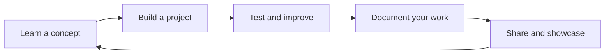

  

<h1 align="center">AlmaBetter School</h1>

  <strong>Your Success, Our Mission!</strong> 
  Empowering future-ready talent through AI, Data Science, Software Engineering, hands-on projects, and career-focused learning.

  <a href="https://almabetter.com/">Website</a> ·
  <a href="https://github.com/almabetter-school-ds?tab=repositories">Explore repositories</a> ·
  <a href="https://almabetter.com/courses">Explore courses</a>

  
  
  

---

## Welcome 👋

This GitHub space brings together practical code, experiments, learning projects, and technical resources across modern AI and software development. Explore projects, understand how they work, and use them as a starting point for your own learning.

> **Learn with purpose. Build with practice. Grow through what you create.**

## What you'll find here

<table>
  <tr>
    <td width="50%" valign="top">
      <h3>🤖 AI & Machine Learning</h3>
      Experiments, model-building exercises, applied AI, and intelligent applications.
    </td>
    <td width="50%" valign="top">
      <h3>📊 Data Science & Analytics</h3>
      Data exploration, notebooks, visualisation, statistical thinking, and insights from data.
    </td>
  </tr>
  <tr>
    <td width="50%" valign="top">
      <h3>✨ Generative & Agentic AI</h3>
      Examples that explore LLMs, AI-enabled workflows, retrieval, and tool-using systems.
    </td>
    <td width="50%" valign="top">
      <h3>💻 Software Engineering</h3>
      Applications, APIs, reusable components, and practical development patterns.
    </td>
  </tr>
  <tr>
    <td width="50%" valign="top">
      <h3>☁️ Cloud, DevOps & Infrastructure</h3>
      Deployment examples, automation, developer tooling, and reliable application practices.
    </td>
    <td width="50%" valign="top">
      <h3>🚀 Hands-on Projects</h3>
      Applied work that connects technical concepts to real-world problems and portfolio building.
    </td>
  </tr>
</table>

## A practical learning loop

## Explore the organization

- **Browse projects:** Visit the [repository list](https://github.com/almabetter-school-ds?tab=repositories) and open the README for each project.
- **Start with the documentation:** Check each repository's setup instructions, dependencies, examples, and known limitations.
- **Learn by building:** Fork or clone repositories where permitted, then experiment in your own branch.
- **Contribute thoughtfully:** Follow the contribution guidance and issue templates provided by an individual repository, when available.

## Start learning

  
  
  

## A note about projects and reuse

Repositories may be maintained by different teams or contributors and can have different maturity levels, dependencies, and usage terms. Review the README and `LICENSE` file in each repository before using or redistributing its code. The license and contribution rules of each project apply to that project.

---

  <strong>Learn. Build. Grow.</strong> 
  <a href="https://almabetter.com/">almabetter.com</a>

